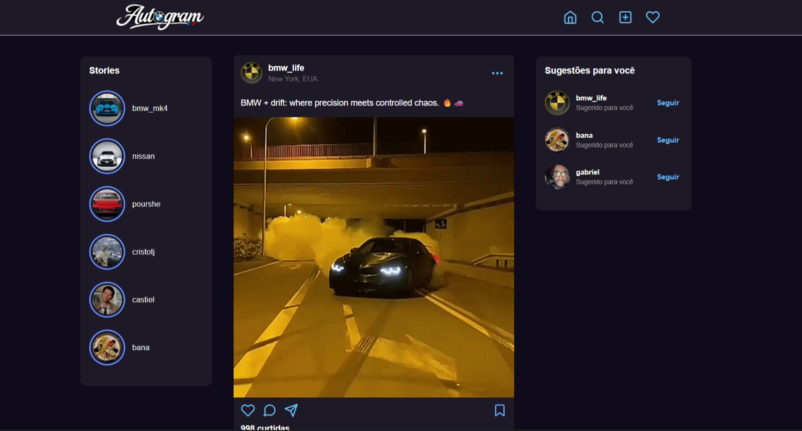
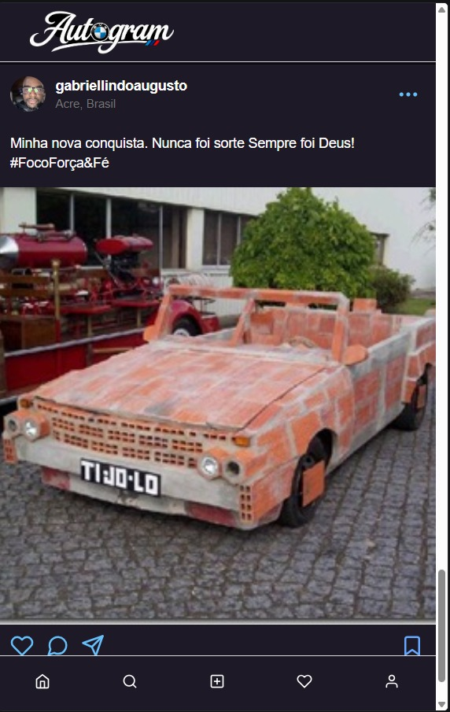
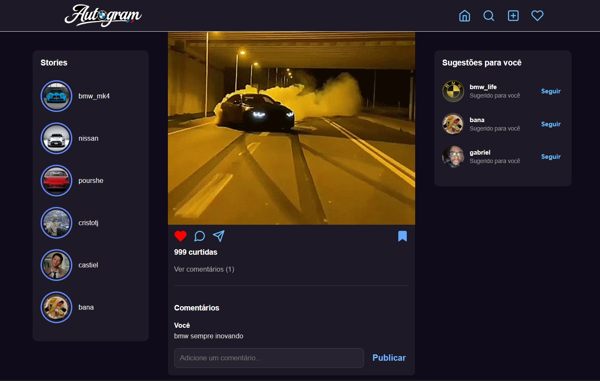

# espelho-espelho-meu

# 🚗 Autogram

O **Autogram** é uma rede social inspirada no Instagram,
desenvolvida especialmente para apaixonados pelo universo
automotivo.

Construída com **React, JavaScript e CSS**, a plataforma
oferece uma interface moderna, responsiva e interativa,
permitindo explorar publicações sobre carros, modificações,
projetos automotivos, competições e eventos.

## ✨ Funcionalidades

- 📸 Feed de publicações com fotos e descrições
- ❤️ Sistema interativo de curtidas
- 💬 Comentários nas publicações
- 🔖 Botão para salvar publicações
- 👤 Perfis de usuários
- 📱 Interface responsiva para celulares e computadores

## 🛠️ Tecnologias utilizadas

- React
- JavaScript
- HTML5
- CSS3
- React Icons

## 🎯 Objetivo

Criar um espaço digital para entusiastas automotivos
compartilharem experiências, descobrirem conteúdos
e se conectarem por meio da paixão por carros.

## Telas do projeto

### 1. Versão Desktop
Interface completa do Cinegram em telas maiores.

### 2. Versão Mobile
Interface responsiva adaptada para dispositivos móveis.

### 3. Funcionalidades de interação
Demonstração das funções de curtir, salvar e comentar publicações.

